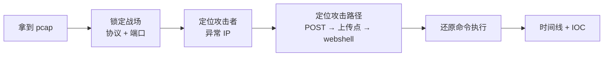

拿到一个 pcap，打开 Wireshark，几千上万条包铺满屏幕。

新手最常见的反应是从第一条开始往下翻——翻到第二百条就迷失了，因为**真正有价值的包可能在第 4000 条**。

流量分析和应急响应一样，靠的不是耐心，是**顺序**。这篇用一个后门排查的场景，把顺序拆开讲。



---

## 一、锁定战场：先搞清楚"该看哪一块"

### 1.1 看协议分级

`统计 → 协议分级`

这一眼解决的是"这个 pcap 里主要是什么流量"。

如果 HTTP 占绝对多数、其他协议几乎没有，那就直接锁定 Web 流量——后面所有分析都不用再考虑 DNS 隧道、SMB 横向这些方向。

> 这一步的价值是**排除**，不是发现。你要先砍掉 90% 无关的包。

### 1.2 看会话，找端口

`统计 → 会话`

协议告诉你是 Web，但 Web 不一定跑在 80。有一次排查里，流量最大的是 **8022** 端口。

非标准端口有个特点：**容易被忽视**。防守方盯着 80/443，攻击者用 8022 一样能做 Web 攻击，而流量设备可能根本没把它当 HTTP 解析。

到这里，"战场"就确定了：

```
协议：HTTP
端口：8022
```

**这两条是后面所有过滤器的前提。**

---

## 二、定位攻击者：谁在做不正常的事

有了战场，下一步是找"人"。

### 2.1 异常 IP 的典型特征

| 特征 | 含义 |
|---|---|
| 单个 IP 请求量远高于其他 | 扫描器 / 爆破 |
| 大量 404 | 目录扫描、路径探测 |
| URI 特别长、带编码 | 注入、目录穿越、WAF 绕过 |
| User-Agent 是工具名（sqlmap、nikto、curl） | 自动化工具 |
| 请求间隔极其规律 | 脚本，不是人 |

最明显的一类：**某个 IP 大量请求不存在的地址**。

正常用户不会去访问 `/admin.php.bak`、`/www.zip`、`/1.php` 这种东西。一个 IP 短时间内访问几十个不存在的路径，结论只有一个：**在扫**。

### 2.2 查看方式

`统计 → 端点`，按包数或字节数排序。

排在最前面的那个 IP，如果它的大部分请求都是 404，基本就是攻击者。

```wireshark
ip.addr == <可疑IP>
http.response.code == 404
```

---

## 三、定位攻击路径：从"扫"到"打进去"

### 3.1 缩小范围：先看 POST

扫描都是 GET。**真正能打进去的动作，绝大多数是 POST**——上传、登录、命令执行、反序列化，都是。

所以第一步筛：

```wireshark
http.request.method == "POST"
```

几千条包，筛完可能只剩几十条。这就是攻击者的"主要动作"。

### 3.2 找上传点

一次典型的后门排查里，POST 集中在两个地址：

```
/upload.php                      ← 攻击入口
/uploads/php_68525da04b2c37.php  ← 落地文件
```

后者的文件名本身就是答案：`php_` 前缀 + 随机串，是典型的**上传组件自动重命名**规则。攻击者上传了一个 `.php`，组件把它改名后存进了可访问目录。

这类文件名一眼可疑的原因是：**它是随机生成的，但后缀是 `.php`**。正常业务上传的文件（图片、文档）不会长这样。

### 3.3 还原上传内容

右键任意一个包 → `追踪 → TCP 流`。

HTTP 是明文，上传的原始内容就在流里：boundary、文件名、文件内容。

如果上传的是 webshell，你能直接在流里看到 `<?php @eval($_POST[...]); ?>` 之类的代码。

**这一步是整个分析里最关键的一步**——它同时给出了：

- webshell 的路径
- webshell 的连接密码 / 参数名
- 攻击发生的确切时间

### 3.4 看它执行了什么

拿到 webshell 路径后，筛这个路径的请求：

```wireshark
http.request.uri contains "php_68525da04b2c37"
```

后面的每一条请求，就是攻击者执行的每一条命令。

命令一般在参数里（`cmd=whoami`、`pass=...`），结果在响应体里。

**如果响应体是空的**，说明是"盲执行"，那就只能靠请求参数推断，或者去服务器上找日志对照。

---

## 四、整理：把包变成一条时间线

分析完不是结束，你要交的是**结论**，不是截图。

| 时间 | 源 IP | 方法 | URI | 关键参数 | 结果 |
|---|---|---|---|---|---|
| 02:01:03 | x.x.x.x | GET | /admin.php.bak | — | 404 |
| 02:02:11 | x.x.x.x | POST | /upload.php | 上传 php 文件 | 200 |
| 02:02:15 | x.x.x.x | POST | /uploads/php_xxx.php | cmd=id | 返回 uid=33(www-data) |
| 02:03:02 | x.x.x.x | POST | /uploads/php_xxx.php | cmd=cat /etc/passwd | 返回内容 |

提取 IOC：

- 攻击源 IP
- webshell 路径
- webshell 密码 / 参数名
- 上传点（漏洞位置）
- 执行的命令列表

**最后一条最容易被忽略，也最重要**：执行过 `cat /etc/passwd`，说明系统账号已经泄露；执行过 `wget http://...`，说明可能有二阶段载荷。

---

## 五、几个容易翻车的点

**① 只看请求，不看响应**

请求只能告诉你"它想干什么"，响应才能告诉你"它干成了没有"。`cmd=id` 返回 403 和返回 `uid=0(root)`，是完全不同的两个结论。

**② 忽略非标准端口**

只筛 `http` 不一定够——Wireshark 对非标准端口的 HTTP 有时不会自动识别。这时候手动 `解码为 → HTTP`，或者直接按 `tcp.port == 8022` 看。

**③ 被扫描流量淹没**

一个扫描器能产生几千条 404。先把它筛掉，再看别的：

```wireshark
ip.addr != <扫描IP>
```

**④ 时间对不上**

pcap 的时间戳可能是 UTC，服务器日志是本地时间。对时间线之前先确认时区，不然报告里的时间全是错的。

---

## 六、速查：常用过滤器

```wireshark
# 只看某端口
tcp.port == 8022

# 只看 HTTP 请求
http.request

# 只 POST
http.request.method == "POST"

# 找扫描
http.response.code == 404

# 跟踪某个 webshell 的全部交互
http.request.uri contains "php_"

# 排除扫描器
ip.addr != 10.0.0.5

# 看某个 IP 的全部流量
ip.addr == 1.2.3.4

# 导出对象（找上传的文件）
文件 → 导出对象 → HTTP
```

---

## 结语

流量分析的核心不是"会不会用 Wireshark"，而是**知道先看什么**。

三步走下来，其实是一句话：

> **先缩小战场（协议 + 端口），再找人（异常 IP），最后找路（POST → 上传点 → webshell）。**

包再多，也只有这三步。剩下的都是熟练度问题。
